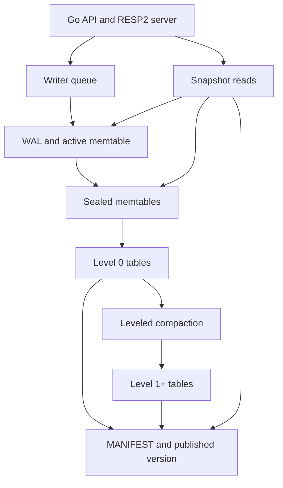

# Ember

Ember is a single-node, ordered key-value database written in Go. Its embedded
engine uses a log-structured merge tree. An optional TCP server exposes a
Redis-compatible RESP2 subset.

The project makes storage behavior inspectable. You can follow a write from
its WAL record to a sorted table, examine the MANIFEST edits that make files
live, and compare write latency across durability policies.

## Quickstart

Use Go 1.22 or later on Linux. Building and testing the engine uses the Go
standard library. The RESP session uses a separately installed `redis-cli`.

```sh
make build
./bin/emberd -dir ./ember-data -addr 127.0.0.1:6380
```

Open another terminal.

```text
$ redis-cli -p 6380
127.0.0.1:6380> PING
PONG
127.0.0.1:6380> SET visits 41
OK
127.0.0.1:6380> INCR visits
(integer) 42
127.0.0.1:6380> GET visits
"42"
127.0.0.1:6380> QUIT
```

Stop the server with Ctrl+C. The inspector's `verify` command takes the
database lock and requires the server to be offline.

```sh
./bin/emberctl manifest ./ember-data
./bin/emberctl verify ./ember-data
./bin/emberctl wal ./ember-data/000002.wal
./scripts/redis-smoke.sh
```

The WAL filename above is for a fresh database. Use the MANIFEST output to
find the current WAL after rotation. `emberctl sst FILE` prints a table's
keys, sequence numbers, block count, and Bloom filter parameters.

## What the engine supports

- WAL-backed atomic batches, group commit, and configurable sync.
- Skip-list memtables, background flush, leveled compaction, and
  write backpressure.
- Prefix-compressed SSTable blocks, Bloom filters, a sharded LRU block cache,
  and optional DEFLATE compression.
- Sequence-pinned snapshots, bounded forward iterators, expiry, and
  serialized read-modify-write operations.
- Checksummed storage formats, MANIFEST replay, and WAL tail recovery.



### Durability policies

| Server flag | Acknowledgment |
| --- | --- |
| `-sync always` (default) | A write group is synced before its successful writes are acknowledged. |
| `-sync periodic -sync-interval 10ms` | Writes can be acknowledged before the next WAL sync. |
| `-sync never` | Routine WAL syncs are skipped. Clean close still syncs replay WALs. |

For `always`, recovery preserves acknowledged writes under the filesystem's
successful sync guarantees. If an operation returns a WAL or MANIFEST I/O
error, its outcome can be ambiguous. Reopen the database to recover the
durable state before retrying a non-idempotent operation.

### RESP2 compatibility

Ember supports `PING`, `ECHO`, `SET`, `GET`, `DEL`, `EXISTS`, `MSET`,
`MGET`, `SETNX`, `INCR`, `DECR`, `INCRBY`, `EXPIRE`, `TTL`, `KEYS`,
`SCAN`, `DBSIZE`, `INFO`, `FLUSHALL`, `COMMAND`, `QUIT`, `MULTI`, `EXEC`,
and `DISCARD`. `SET` supports `NX`, `XX`, `EX`, `PX`, and `KEEPTTL`.
`SCAN MATCH` and `KEYS` accept literals and a trailing `*` for prefix
matching. Use the same connection throughout a scan. Each page sees a fresh
read view, so writes between pages can change the results.

`EXEC` serializes the queued data commands with other writers. Reads inside
the transaction see earlier staged changes, and successful mutations are
published together. Other clients can write between `MULTI` and `EXEC`.
Queue-time errors abort the transaction. A command-level
execution error is returned in the reply array alongside other command
results. A storage failure can abort the whole batch. `WATCH` and queued
keyspace or administrative commands are outside the supported subset.

## Tests and container

| Command | Result |
| --- | --- |
| `make test` | Unit, randomized model, fault, and TCP integration tests |
| `make race` | The same suite with the Go race detector |
| `make cover` | Coverage profile and per-function statement percentages |
| `make fuzz FUZZTIME=30s` | Native Go fuzzing of the RESP command decoder |
| `make lint` | Formatting and golangci-lint v2 checks |

```sh
docker build -t ember:local .
docker volume create ember-data
docker run --rm --name ember -p 127.0.0.1:6380:6380 -v ember-data:/data ember:local
```

The final image runs the server as UID and GID 65532. A host bind mount must
give that UID access to the database directory.

## Benchmark methodology

Choose an existing directory on the storage device you want to measure.
`emberbench` creates a fresh database per workload beneath that directory.
It prefills read, overwrite, and mixed workloads outside the timed interval.
Warm-up also runs outside that interval. Fill warm-up uses a disjoint range
in the same database. A run can therefore include background flush and
compaction work triggered by setup or warm-up.

```sh
mkdir -p ./bench-data
make bench BENCH_ARGS='-dir ./bench-data -ops 100000 -keys 100000 -warmup 10000 -workers 1 -key-size 16 -value-size 100 -seed 42 -sync always'
```

Run each configuration at least three times. Record the CPU, memory, OS,
Go version, filesystem, and storage device. Use one worker for a strictly
sequential write stream. Use a separate multi-worker run to observe group
commit. Keep the sync policy, key distribution, sizes, and seed fixed when
comparing configurations. The mixed workload assigns 90% of operations to
reads and 10% to overwrites. The tool measures per-operation latency and
reports nearest-rank percentiles. Retain the individual runs and label any
summary statistic.

| Environment | Record before running |
| --- | --- |
| CPU and memory | |
| OS, filesystem, and storage | |
| Go version and Ember commit | |
| Sync mode, workers, operations, and keys | |
| Warm-up, seed, and key/value sizes | |

| Workload | Ops/sec | p50 | p95 | p99 |
| --- | ---: | ---: | ---: | ---: |
| Sequential fill | | | | |
| Random fill | | | | |
| Random read | | | | |
| Sequential read | | | | |
| Overwrite | | | | |
| Mixed 90/10 | | | | |

For a separate network smoke run with the Redis benchmark client, use a
disposable server database.

```sh
redis-benchmark -p 6380 -t ping,set,get,mset -n 1000 -c 4 -P 4
```

## Comparison with LevelDB and RocksDB

Ember follows the same broad ordered-storage model as LevelDB, including
WAL replay, immutable sorted tables, compaction, atomic batches, and
snapshots. Ember implements the storage stack in Go and includes a RESP2
server and a disk inspector. Its on-disk formats are Ember-specific.
[LevelDB project](https://github.com/google/leveldb)

RocksDB exposes a broader set of storage policies and APIs, including
multiple compaction styles, column families, and extensive tuning options.
Ember uses one leveled policy and one logical database to keep the
implementation and its failure cases small enough to inspect.
[RocksDB basic operations](https://github.com/facebook/rocksdb/wiki/Basic-Operations)
[RocksDB compaction](https://github.com/facebook/rocksdb/wiki/Compaction)

## Known limitations

- One process owns a database directory. The server defaults to loopback
  and implements RESP2 string operations without authentication or TLS.
- Iterators move forward with `Next` and reposition with `Seek`. Reverse
  iteration and `Prev` are out of scope.
- The engine holds one file handle per live or pinned SSTable. Long-lived
  snapshots delay file reclamation and can increase disk use. Iterators
  start a merge cursor for each participating table.
- The MANIFEST is append-only. Replay time and the in-memory file-number
  history grow with the edit history. This version has no checkpoint or
  MANIFEST rollover.
- A WAL checksum failure ends replay for that file. The engine can
  recover the intact prefix, and records after the first bad record may be
  lost. The crash tests model interruptions and sync failures. They cannot
  recover arbitrary damage to data that was already synced.
- Compaction uses one background worker. Tombstones and expired values
  are reclaimed during eligible compactions. The final level is not
  rewritten solely to reclaim expired data.
- The engine accepts keys up to 1 MiB. RESP accepts bulk arguments up to
  16 MiB, request argument bytes up to 32 MiB, and replies up to about
  64 MiB. `KEYS` and `DBSIZE` scan the keyspace. A connection can evict
  older scan cursors when its cursor cache fills.

## Future work

Add a bounded table-handle cache and MANIFEST checkpoints. Compare leveled
and size-tiered compaction using write amplification and tail latency.
Evaluate block codec tradeoffs and the storage and networking changes a
Raft replication layer would require.

[Architecture](docs/ARCHITECTURE.md) · [Disk formats](docs/FORMATS.md) ·
[Design decisions](docs/DESIGN_DECISIONS.md)

Licensed under the [MIT License](LICENSE).
