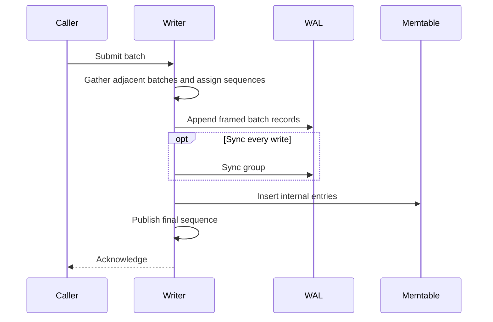
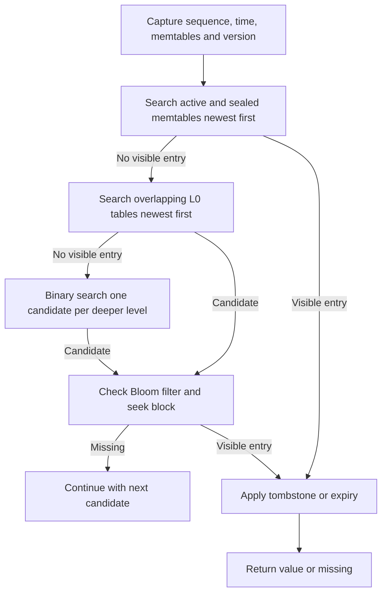
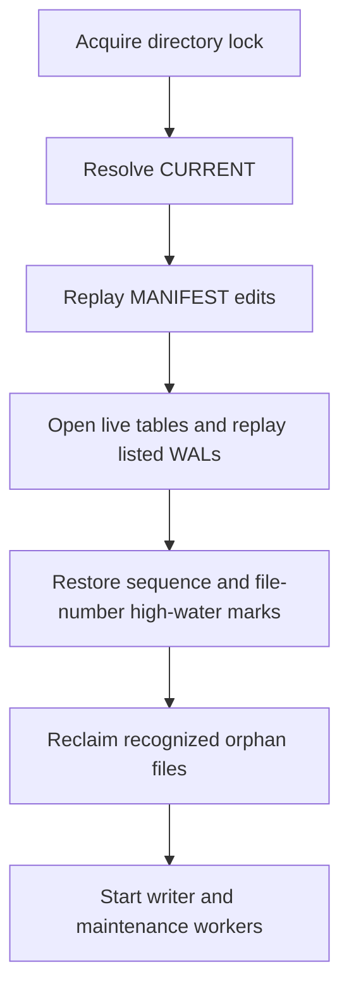
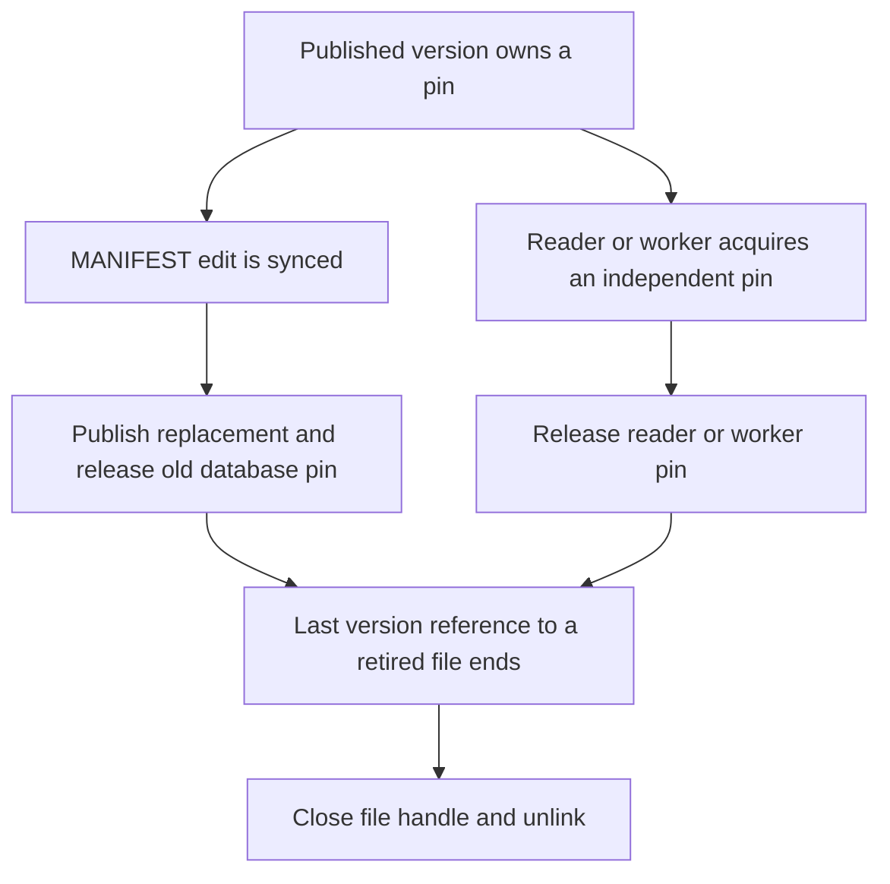

# Architecture

Ember owns a directory under an advisory `LOCK`. The MANIFEST is the
authority for the live table set and replay WALs. The Go API and RESP2
server share one writer and one maintenance worker. Readers capture a
sequence and a version, then perform reads outside the main state mutex.

## Write path

Each batch is a separate logical WAL record even when several batches share
one append and sync. The single writer assigns a contiguous sequence range
to each batch. It inserts all group entries before publishing the final
sequence. A reader with the earlier sequence skips every new entry.

A serialized `Update` is a barrier between write groups. It sees one read
view, overlays staged changes, and submits one batch. Read-modify-write
RESP commands use this path. A callback must use its transaction object for
staged writes and must not wait on another write from inside the callback.

When the active skip list reaches the configured threshold, the writer
creates a new WAL. It publishes that WAL in a synced MANIFEST edit, then
switches to a new active memtable and seals the old one. The maintenance
worker flushes sealed memtables in order. A flush installs a complete
SSTable before committing the edit that adds it and removes the old WAL
from the replay list. The obsolete WAL can then be unlinked.

## Read path

Internal keys sort by user key ascending and sequence descending, then
operation kind. A point read accepts the first entry at or below the
captured sequence. A tombstone or expired value hides older entries. A
Bloom hit is only a possibility, so the reader still checks the exact
key. The table index locates a data block, and block restart points bound
the work needed to reconstruct prefix-compressed keys.

An iterator merges the memtable and table cursors. It seeks each source to
the lower bound or requested key, emits one visible version per user key,
and stops at the exclusive upper bound. Snapshots and iterators each hold
their own read view. A snapshot's expiry time is fixed even while wall time
advances. Within one open database, the captured wall-clock timestamp is
clamped to its previous high-water mark.

## Recovery sequence

A file install writes a sibling temporary file, syncs it, renames it, and
syncs the parent directory. A MANIFEST edit can reference the file after
that ordering completes. New databases install the initial WAL, then the
MANIFEST, then `CURRENT`.

Recovery truncates and syncs an incomplete final MANIFEST record if the
file has a valid initial edit. A complete record with a bad checksum, an
invalid edit, or a missing `CURRENT` target prevents opening. WAL recovery
replays complete batches and repairs the suffix after the first torn or
invalid batch. Underlying read errors propagate. A malformed WAL tail is
reported because corruption can discard records after the first bad one.

Before the database accepts writes, reopen syncs the recovered MANIFEST
and then the directory containing `CURRENT`. A previous sync failure can
leave a complete edit or a renamed `CURRENT` visible to a second opener.
The new syncs make that metadata durable before new writes depend on it.

Recovery advances sequence allocation past the maximum of MANIFEST, table,
and replayed WAL sequences. It starts file allocation beyond observed
numbered files and the persisted allocation high-water mark. File
references come from replay. Recognized unreferenced files and abandoned
temporary installs can be removed once the live set is known.

## Compaction

L0 is selected by file count. The picker starts with the oldest L0 file,
expands to the transitive overlap closure in L0, and includes intersecting
files from L1. For higher levels, total bytes are compared with a budget
that grows tenfold at each level. An overfull level contributes one source
file and the overlapping range in its destination level.

The worker merges the inputs in internal-key order. It preserves versions
above the oldest registered read sequence and the newest version at or below
that sequence. An expired value becomes a tombstone if the earliest
registered read timestamp is past its expiry. A floor tombstone can be
dropped once file metadata rules out an older value in every table outside
the merge. Newer memtables and runs still participate in read ordering.

Output files split near a size target at user-key boundaries. A synced
MANIFEST edit adds the outputs and retires the inputs as a unit. Slowdown
adds a short delay at high L0 counts. The hard stall waits for maintenance
when L0 or sealed memtables exceed the configured pressure thresholds.

## Version lifetime and locking

The database state mutex protects the published version, active and sealed
memtable pointers, sequence, table registry, and read-view registry.
Structural edits are serialized by the edit mutex. Publication acquires
the state mutex after the edit mutex. MANIFEST I/O and SSTable building run
outside the state mutex. The version set keeps its own reference counts,
and the skip list and cache use their own locks. Reader and worker pins
keep table handles valid through replacement.

`Reset` publishes a new empty version with a fresh WAL. The generation
counter rejects output from maintenance work started against an older
generation. During close the database stops admitting writes, drains the
writer, stops maintenance, and waits for in-progress read calls before
closing file handles. The clean close syncs WALs still needed for recovery.
